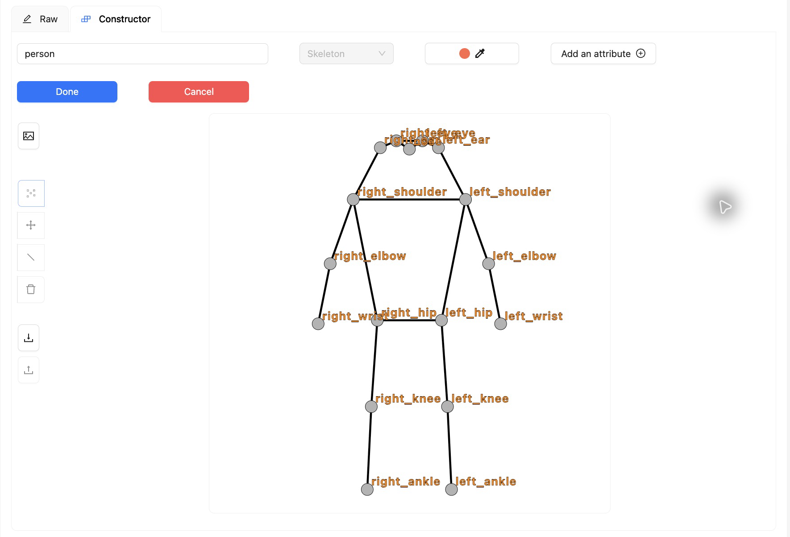
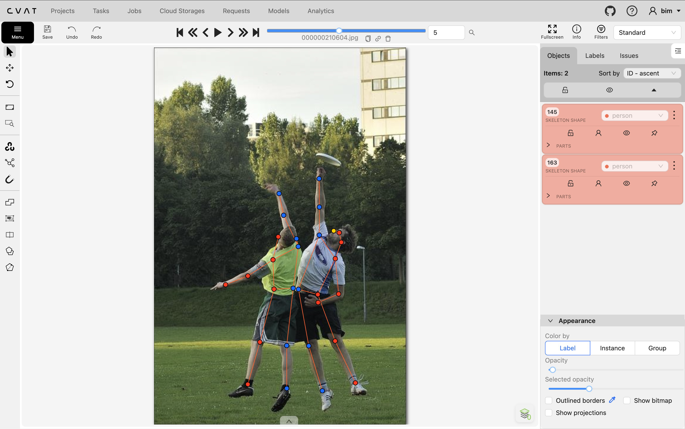
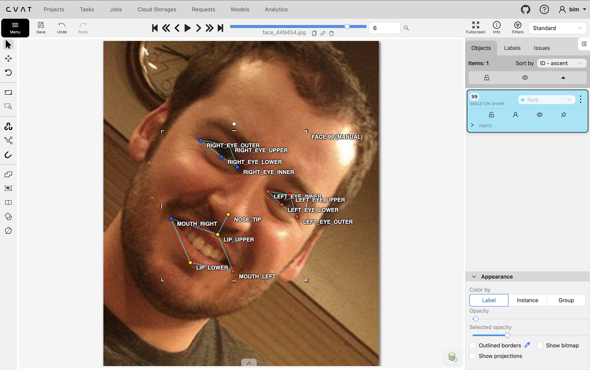
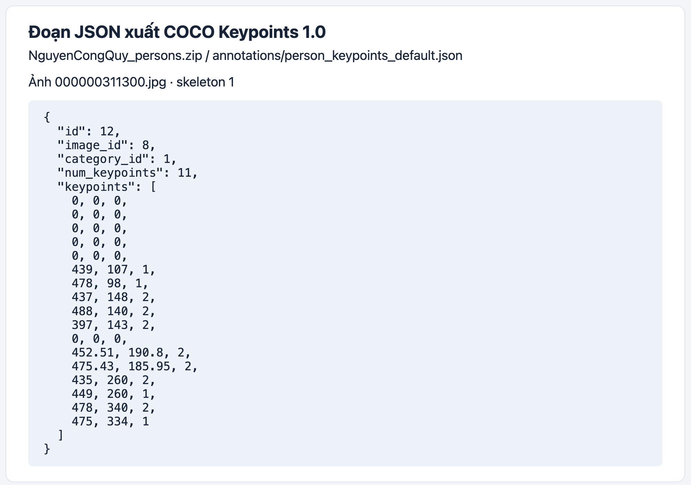

# Báo cáo cá nhân — Nguyễn Công Quý (2A202603149)

Dữ liệu: 12 ảnh người COCO val2017 (Lin et al., 2014) và 8 ảnh chân dung Wikimedia Commons, chỉ dùng trong lớp.

## 0. Thông tin học viên

- Họ tên: Nguyễn Công Quý
- MSSV: 2A202603149
- Email: 26ai.quync@vinuni.edu.vn
- Repository hiện tại: [K5-L2A-Day04-NguyenCongQuy-2A202603149-KeypointPose-Student](https://github.com/nguyencongquy/K5-L2A-Day04-NguyenCongQuy-2A202603149-KeypointPose-Student)
- Phiên bản CVAT (Help → About): 2.74.1
- Máy: macOS · RAM 24 GB · CVAT local qua Docker Desktop
- Bộ ảnh (`src/exports/assignment.json` do `lab.py setup` tạo): có
- Giờ bắt đầu: 16:20
- Giờ kết thúc: 18:45

## 1. Kiểm tra label (CP0)

| Label | Kiểu | Số điểm | Tên điểm đúng bảng của lab? | Đúng thứ tự? | Số cạnh |
|---|---|---:|---|---|---:|
| `person` | Skeleton | 17 | Có | Có | 19 |
| `face` | Skeleton | 13 | Có | Có | 13 |

Mẫu `person` dựng theo người quay mặt về camera. Các điểm `left_*` nằm bên phải khung mẫu.

Để đổi cờ cho một điểm, rê chuột lên đúng điểm và bấm `Q` cho `occluded` hoặc `O` cho `outside`.

## 2. Số lượng đã gán và thời gian (CP1, CP2)

| Nhóm ảnh | Số ảnh | Số skeleton đã gán | Số người dưới 60 px (không gán) | Số poster / gương / màn hình bỏ qua | Thời gian (phút) |
|---|---:|---:|---:|---:|---:|
| `easy` | 5 | 5 | — | — | — |
| `occluded` | 3 | 6 | — | — | — |
| `back` | 2 | 4 | — | — | — |
| `small` | 1 | 2 | — | — | — |
| `crowd` | 1 | 3 | — | — | — |
| `faces` | 8 | 8 | — | — | — |

Tổng số trong hai bản xuất là 20 skeleton người trên 12 ảnh và 8 skeleton mặt trên 8 ảnh. Dấu `—` là không có số liệu để điền.

- Số ảnh người đã xong ở phút 105: không có số liệu.
- Từ lúc bắt đầu đến lúc kết thúc là 2 giờ 25 phút. Không có số liệu riêng cho CP1, CP2 và CP3.
- Ảnh khó nhất với tôi là `000000157271.jpg`. Người phía trước che một phần cánh tay và khuôn mặt của người phía sau, nên tôi phải xem kỹ điểm nào còn ước lượng được.

## 3. Bảng ca khó (CP1, CP2)

| Ảnh | Người | Điểm | Cờ trong bản xuất | Chỗ dễ nhầm | Lý do |
|---|---|---|---:|---|---|
| `000000157271.jpg` | Người áo trắng | `left_elbow` | 0 | `v = 1` hay `v = 0` | Cánh tay bị che, không đủ dấu hiệu để xác định khuỷu tay. |
| `000000157271.jpg` | Người áo trắng | `left_wrist` | 1 | `v = 1` hay `v = 0` | Đầu cánh tay và phần bàn tay lộ ra cho thêm dấu hiệu để ước lượng cổ tay. |
| `000000157271.jpg` | Người áo trắng | `left_eye` | 0 | `v = 1` hay `v = 0` | Khuôn mặt chỉ lộ một phần và không định được vị trí mắt trái. |
| `000000326480.jpg` | Người áo đen ở giữa | `left_wrist` | 2 | Dễ nhầm tay của người bên cạnh | Ba người đứng sát nhau. Lần từ vai qua khuỷu đến cổ tay của cùng một người để kiểm tra điểm. |

## 4. Bảng tự review (CP3)

Bảng tổng hợp từ ghi chú đối chiếu ảnh và nhãn trong CVAT, có hỗ trợ của Codex. Phạm vi gồm 5 ảnh người và 3 ảnh mặt.

| Ảnh | Người / mặt | Điểm | Mã lỗi | Ghi chú | Đã sửa? |
|---|---|---|---|---|---|
| `000000580257.jpg` | Hai người ngồi ghế | Cổ chân trái và hông | `ok` | Cổ chân trái của người áo tím ra ngoài khung. Hông bị túi che đã có cờ phù hợp. | Giữ nguyên |
| `000000326480.jpg` | Người áo đen ở giữa | `left_wrist` | `position` | Điểm lệch về bàn tay, đã dời về chỗ nối bàn tay với cẳng tay. | Có |
| `000000311300.jpg` | Người áo đen | `right_ankle` | `vis_flag` | Hai chân chồng nhau, không lần được cẳng chân phải đến cổ chân. Đã đặt `v = 0`. | Có |
| `000000210604.jpg` | Hai người với đĩa | Tay trái và tay phải | `ok` | Lần từng tay từ vai đến cổ tay. Người áo xanh quay lưng và giơ tay phải. | Giữ nguyên |
| `000000167027.jpg` | Người sát mép trái | `right_ear` | `vis_flag` | Vùng gáy mờ và sát mép, không xác định chắc vị trí tai phải. Đã đặt `v = 0`. | Có |
| `face_79367.jpg` | Mặt | `lip_upper` | `position` | Điểm lệch về khe miệng, đã dời ra giữa viền môi trên. | Có |
| `face_79367.jpg` | Mặt | `lip_lower` | `position` | Điểm nằm dưới môi, đã dời lên giữa viền môi dưới. | Có |
| `face_380754.jpg` | Mặt | `lip_lower` | `position` | Điểm nằm thấp dưới viền môi, đã dời lên mép ngoài môi dưới. | Có |
| `face_256814.jpg` | Mặt đeo kính râm | 8 điểm mắt | `ok` | Hai cụm điểm nằm sau tròng kính và đều có cờ `occluded`. | Giữ nguyên |

Tổng hợp số lỗi theo mã:

| `lr_swap` | `vis_flag` | `position` | `missing` | `extra` | `ok` |
|---:|---:|---:|---:|---:|---:|
| 0 | 2 | 4 | 0 | 0 | 3 |

Ở ảnh `000000311300.jpg`, cổ chân phải có thể dùng `v = 1` nếu lần được đường cẳng chân tới khớp. Hai chân chồng lên nhau và chỉ thấy rõ một đường cẳng chân, nên bản cuối dùng `v = 0`.

## 5. Kiểm file xuất và kết quả tự kiểm (CP4)

Đối chiếu hai skeleton người và một skeleton mặt trong JSON đã xuất:

| File | Ảnh và thứ tự skeleton | Số phần tử `keypoints` | Cờ hiển thị | `num_keypoints` |
|---|---|---:|---|---|
| `NguyenCongQuy_persons.zip` | `000000311300.jpg` #1 | 51 | 6 điểm `v=0`, 4 điểm `v=1`, 7 điểm `v=2` | 11 = 4 + 7 |
| `NguyenCongQuy_persons.zip` | `000000167027.jpg` #1 | 51 | 7 điểm `v=0`, không có `v=1`, 10 điểm `v=2` | 10 = 0 + 10 |
| `NguyenCongQuy_faces.zip` | `face_256814.jpg` #1 | 39 | Không có `v=0`, 8 điểm `v=1`, 5 điểm `v=2` | 13 = 8 + 5 |

CVAT xuất `occluded` thành `v=1`, `outside` thành `v=0`. Các điểm `outside` có thể ra `(0, 0)` hoặc còn tọa độ cũ: ở mẫu `000000167027.jpg` #1, 5 trong 7 điểm `v=0` còn tọa độ cũ. Không tính chúng vào `num_keypoints`.

Đã xác nhận trạng thái `completed` trên CVAT cho cả job Persons #11 và Faces #12. Lần xuất cuối sau khi đổi trạng thái báo ĐẠT với 0 lỗi và 2 cảnh báo.

Tóm tắt từ `src/check_submission.py`:

```text
- File person: NguyenCongQuy_persons.zip
  Số ảnh: 12 · số skeleton `person`: 20 · mỗi annotation 51 số
  Skeleton theo ảnh: 000000056651=2, 000000072098=1, 000000157271=2, 000000167027=2, 000000176000=1, 000000210604=2, 000000294329=1, 000000311300=2, 000000326480=3, 000000343057=1, 000000349521=1, 000000580257=2
  Cờ v: v=2 217 (64%) · v=1 43 (13%) · v=0 80 (24%)
  num_keypoints trung bình: 13.0
- File face: NguyenCongQuy_faces.zip
  Số ảnh: 8 · số skeleton `face`: 8 · mỗi annotation 39 số
  Skeleton theo ảnh: face_137371=1, face_147624=1, face_204787=1, face_256814=1, face_380754=1, face_425647=1, face_449454=1, face_79367=1
  Cờ v: v=2 96 (92%) · v=1 8 (8%) · v=0 0 (0%)
  num_keypoints trung bình: 13.0
- Ghi chú: 34 điểm v = 0 vẫn mang tọa độ cũ (CVAT 2.x xuất như vậy; chuẩn COCO ghi 0, 0). Không phải lỗi: điểm v = 0 bị bỏ qua khi huấn luyện và khi chấm.
- Số [LỖI]: 0 · số [CẢNH BÁO]: 2
Kết quả: ĐẠT (đọc lại từng cảnh báo ở trên)
```

**Hai cảnh báo giữ nguyên:** ở ảnh `000000167027.jpg`, độ trải theo chiều dọc của các điểm đã gán là 59 px (#1) và 53 px (#2). Khi đối chiếu ảnh, chiều cao nhìn thấy từ đỉnh đầu đến giày của cả hai người đều trên 60 px. Chênh lệch do trình kiểm tra đo theo các điểm được gán, không đo toàn thân.

## 6. Ảnh chụp màn hình

1. Label `person` trong label constructor (đủ 17 điểm có tên):

   

2. Một người quay lưng đã gán, cờ đã đặt:

   

3. Một khuôn mặt đã gán 13 điểm, phóng to vùng mắt:

   

4. Một đoạn JSON xuất của một người:

   

Nguồn ảnh: COCO val2017 / Wikimedia Commons.

## 7. Tự đánh giá

1. Lỗi bạn mắc nhiều nhất hôm nay, và cách bạn sẽ tránh ở dự án thật:

   Tôi hay nhầm giữa `v = 1` và `v = 0`. Lúc đầu tôi chưa quen nên có chỗ bị che nhưng chưa bật cờ, đường nối vẫn là nét liền. Lần sau tôi sẽ phóng to và kiểm tra từng điểm bị che trước khi lưu. Nếu còn ước lượng được vị trí thì đặt `v = 1`. Nếu không đủ dấu hiệu để ước lượng thì đặt `v = 0`.

2. Một quy tắc bạn đề xuất thêm vào guideline (kèm ảnh ví dụ nếu có):

   Tôi đề xuất thêm ví dụ cho ba ca dễ nhầm: người quá nhỏ, người quay lưng và người chỉ lộ nửa thân. Dùng ngưỡng 60 px của lab để quyết định có gán skeleton hay không. Với người đủ ngưỡng, phóng to rồi xét từng điểm. Gán các điểm nhìn thấy hoặc ước lượng được, đặt `v = 0` cho các điểm còn lại. Khó vẽ bounding box hay polygon là dấu hiệu nên kiểm tra kỹ từng khớp.

3. Nhãn của bạn đi vào model ở đâu? Chọn một lỗi bạn đã sửa và nói nó sẽ làm model học sai thế nào (heatmap, trọng số trong loss, hay bước lật ảnh):

   Khi huấn luyện, tọa độ keypoint cho model biết vị trí cần dự đoán, còn cờ `v` cho biết điểm nào được tính vào loss. Ví dụ ở ảnh `000000311300.jpg`, cổ chân phải bị che và không đủ dấu hiệu để ước lượng. Nếu để `v = 1`, model sẽ học theo một vị trí cổ chân đoán thiếu căn cứ. Đặt `v = 0` giúp bỏ điểm đó khỏi phần tính lỗi vị trí.

## 8. Khó khăn và lỗi kỹ thuật

- Lúc chạy `lab.py check`, tên máy chủ Nuclio trỏ sai địa chỉ, có thể làm CVAT đứng ở màn hình kết nối. Script đã ghi cấu hình override, khởi động lại `cvat_server` và kiểm tra CVAT truy cập được.
- Lần xuất đầu báo hai job chưa `completed`. Sau khi đổi trạng thái trong CVAT, lần xuất cuối báo ĐẠT với 0 lỗi. Mục 5 giải thích hai cảnh báo về độ trải theo chiều dọc của keypoint.

## Bonus (nếu làm)

### B1 — Ba ảnh người khó thêm

Task `persons-extra-NguyenCongQuy`, job #13 đã lưu và chuyển sang `completed`.

| Ảnh | Số skeleton | Số người dưới 60 px bị bỏ qua | Ca khó đã rà |
|---|---:|---:|---|
| `000000161603.jpg` | 4 | 0 | Hai người phía trái đứng chồng nhau. Hai người ở cửa sổ bị bò che phần thân dưới. Chỉ giữ điểm nhìn thấy hoặc ước lượng đủ chắc. |
| `000000254060.jpg` | 2 | 0 | Tách người lái và người ngồi sau xe máy, loại các nhãn trùng và phần xe đạp bị nhận nhầm. Các chi khuất hoàn toàn của người ngồi sau dùng `outside`. |
| `000000517702.jpg` | 3 | 0 | Hai người quay lưng dưới ô và một người bị cắt phần thân trên ở góc ảnh. Rà tay từng người để tránh nối sang người bên cạnh. Mặt sau ô và các khớp ngoài khung dùng `outside`. |

Đã đối chiếu đủ 17 điểm cho mỗi skeleton, kiểm tra trái/phải theo người và kiểm tra cờ từng điểm. File xuất `NguyenCongQuy_bonus_persons.zip` dùng COCO Keypoints 1.0, không kèm ảnh.

```text
- File person: NguyenCongQuy_bonus_persons.zip
  Số ảnh: 3 · số skeleton `person`: 9 · mỗi annotation 51 số
  Skeleton theo ảnh: 000000161603=4, 000000254060=2, 000000517702=3
  Cờ v: v=2 65 (42%) · v=1 27 (18%) · v=0 61 (40%)
  num_keypoints trung bình: 10.2
- Số [LỖI]: 0 · số [CẢNH BÁO]: 2
Kết quả: ĐẠT (đọc lại từng cảnh báo ở trên)
```

Hai cảnh báo của ảnh `000000161603.jpg` đo độ trải các điểm còn gán là 48 px và 28 px. Hai skeleton thuộc hai người phía cửa sổ có thân dưới bị bò che. Giữ cả hai vì cơ thể bị che tiếp tục xuống dưới, và đánh `outside` cho các khớp không định vị được. Chiều cao phần điểm còn gán thấp hơn chiều cao người trong cảnh.

### B2 — Năm ảnh khuôn mặt đen trắng

Task `faces-extra-NguyenCongQuy`, job #14 đã lưu và chuyển sang `completed`. File `NguyenCongQuy_bonus_faces.zip` chứa 5 ảnh và 5 skeleton, mỗi ảnh đúng một skeleton mặt 13 điểm.

| Ảnh | Số skeleton | Số phần tử `keypoints` |
|---|---:|---:|
| `face_274219.jpg` | 1 | 39 |
| `face_379585.jpg` | 1 | 39 |
| `face_45276.jpg` | 1 | 39 |
| `face_494518.jpg` | 1 | 39 |
| `face_507166.jpg` | 1 | 39 |

Ảnh không màu làm việc phân biệt viền mí, khóe miệng với bóng đổ khó hơn. Trong bộ ảnh này, ảnh `face_45276.jpg` có vùng mặt khá tối, còn ria mép ở `face_274219.jpg` làm viền môi trên khó nhìn hơn. Cần phóng to và bám mép nhìn thấy khi đặt điểm.

Cờ visibility trên ảnh hồng ngoại vẫn xét theo điểm có nhìn thấy hay không. Nếu nhìn rõ mắt qua tròng kính thì dùng `v = 2`. Nếu kính che mắt nhưng còn ước lượng chắc vị trí theo gọng thì dùng `v = 1`. Nếu không định vị được thì dùng `v = 0`. Việc ảnh là hồng ngoại không tự quyết định cờ. Năm ảnh được giao ở B2 đều là chân dung đen trắng và không có kính râm để kiểm tra trực tiếp tình huống đó.

```text
- File face: NguyenCongQuy_bonus_faces.zip
  Số ảnh: 5 · số skeleton `face`: 5 · mỗi annotation 39 số
  Skeleton theo ảnh: face_274219=1, face_379585=1, face_45276=1, face_494518=1, face_507166=1
  Cờ v: v=2 65 (100%) · v=1 0 (0%) · v=0 0 (0%)
  num_keypoints trung bình: 13.0
```

Kiểm tra chung hai file bonus báo ĐẠT, 0 lỗi và 2 cảnh báo thuộc B1 như đã giải thích. Cả bốn job #11, #12, #13 và #14 đã ở trạng thái `completed`.

## 9. Tài liệu tham khảo và công cụ AI đã dùng

- [Hướng dẫn gán keypoint](../../docs/GUIDELINE.md) và [hướng dẫn bằng hình](../../docs/HUONG_DAN_BANG_HINH.md).
- Nhãn nháp 17 điểm cho ảnh người được tạo tự động.
- Codex hỗ trợ khắc phục lỗi kỹ thuật và giải thích kết quả của script kiểm tra.
